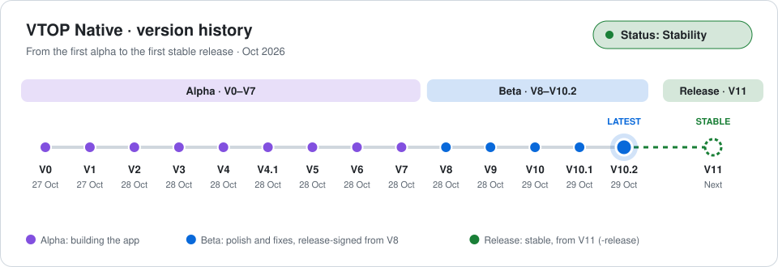

# VTOP Native (VIT Bhopal Campus)

**VTOP, rebuilt as a real Android app.** VTOP Native is an unofficial, fully native app for VIT Bhopal's VTOP portal ([vtop.vitbhopal.ac.in](https://vtop.vitbhopal.ac.in/vtop)). It signs in with your own VTOP login and VTOP's own captcha, talks directly to the official VTOP backend, and shows everything in fast, clean Material 3 Expressive screens instead of a desktop site squeezed onto your phone. It's **for VIT Bhopal University students only**.

- **Your day at a glance**: today's classes with the one in progress highlighted, attendance with "can skip / must attend" counts, marks, grades, exam countdowns and curriculum progress
- **The whole portal, natively**: every module in VTOP's menu opens as a native screen, with forms, uploads, receipts, gate passes and downloads; VTOP is never shown as a web page
- **Always in step with VTOP**: the menu and dashboard are read live, so when the SDC team adds or moves something, the app follows
- **Fast and offline-ready**: pages open instantly from what the app has saved and stay readable when VTOP is down; pull down or **double-tap a tab** to reload
- **System Status**: tracks VTOP's uptime and can notify you when it goes down, without mistaking your own bad signal for a VTOP outage
- **Made for every screen**: dark and light themes, frosted-glass bars, smooth motion, and layouts for phones, foldables, tablets and laptops

Not affiliated with VIT. Your credentials go only to `vtop.vitbhopal.ac.in`.

> [!IMPORTANT]
> **We don't collect any data, and none of the students' data is visible to us.** VTOP Native is only an Android-native VTOP client: it runs entirely on your phone and talks to VIT Bhopal's own servers. Nothing is connected to us; there is no server, account, analytics or tracking of ours.

**Latest version:** V10.2-beta · **Status: Stability** · [Changelog](CHANGELOG.md)

> This repository hosts the app's releases (APKs), this README, the changelog, the [licence](LICENSE) and [third-party notices](NOTICE). The app is **closed source**; its source code is not published here.

## Project status: Stability

The beta series has reached **system stability**: the app is feature-complete, release-signed, and recent versions only polish and fix it. **The next version, V11-release, will be the first stable release**, and every version after it carries the `-release` suffix.

<picture>
  <source media="(prefers-color-scheme: dark)" srcset="assets/version-timeline-dark.svg">
  
</picture>

| Stage | Versions | What it meant |
|---|---|---|
| **Alpha** | V0 – V7 | Building the app: sign-in, native screens for every module, offline caching, System Status, the design system |
| **Beta** | V8 – V10.2 (latest) | Polish and fixes on a complete app; release-signed APKs from V8 on |
| **Stability** | now | The app has reached system stability; preparing the first stable release |
| **Release** | V11 onward | Stable versions, named `V<n>-release` |

## Download and install

1. Open the [latest release](https://github.com/madebyshanxal/NativeVTOP/releases/latest) on your phone and download `VTOP-Native-V<version>.apk` (for example `VTOP-Native-V10.2-beta.apk`).
2. Open the downloaded file. If Android asks, allow your browser or Files app to **install unknown apps**.
3. Tap **Install**, then open **VTOP Native**.

**Updating:** install the newer APK over the old one; your settings and theme are kept. You sign in again only when VTOP has ended your session.

**Coming from an alpha, or a beta downloaded before 29 Oct 2026?** Those builds were signed with a temporary test key, and Android only updates an app with an APK signed by the same key. Uninstall the old app first, then install the new one (this clears its saved data; just sign in again).

**Checking the APK is genuine:** every release from V8-beta on is signed with the app's release key, certificate SHA-256
`70:09:39:69:C0:6F:73:12:B7:5B:A1:E6:3C:D0:54:42:CB:EE:9D:97:30:F6:4F:AF:A9:44:52:E5:88:41:41:10`.
Any APK with a different certificate didn't come from this page.

**Requirements:** Android 8.0 or newer, an internet connection, and a VIT Bhopal VTOP account.

## What it does

| Feature | What you get |
|---|---|
| **Sign-in** | The same as the website: registration number, password and VTOP's own captcha, plus the OTP step when VTOP asks for one. Nothing is remembered; the fields are always empty when you open the app or sign out. |
| **Home** | Your photo, name, register number and programme; VTOP's system status; the portal's own dashboard widgets (course registration, CGPA and credits, proctor message, Spot-light notices); then Attendance, Time Table, Marks, Grades, Exam Schedule and Curriculum at a glance. |
| **Attendance** | Per semester: overall %, a ring per course, how many classes you can skip or must attend to stay at 75 %, debar status, and a day-wise sheet (present, absent, on duty). |
| **Time Table** | Today's classes with the one in progress highlighted, the full week grid exactly like VTOP's (every period including lunch, every slot named, your classes highlighted, today marked), and your registered courses with credits, faculty and status. |
| **Marks and grades** | Every assessment with max, weightage, scored, weighted and class average; per-semester grades with credits; an estimated GPA; Grade History with CGPA and curriculum progress. |
| **Exams and curriculum** | Exam schedule with the nearest exam first and a countdown, venue and seat; curriculum credits per category, earned against required, and the curriculum PDF. |
| **Profile** | Your full VTOP profile with photo; on wide screens and in landscape the sections sit side by side. |
| **Every other module** | Every module in VTOP's menu opens natively: forms, file uploads, tables, receipts, gate passes, QR codes, confirmations and downloads (saved to Downloads/VTOP). New modules VTOP adds show up on their own. |
| **Fee payments** | *Pay Now* opens VIT's payment gateway inside the app; UPI, Paytm and bank apps open as usual. This is the only web page in the app; VTOP itself is never shown as a web page. |
| **System Status** | Checks whether VTOP's portal, login, captcha and student data are up, with 30-day uptime, response times, incidents, and optional notifications when something goes down. When you're offline or on a weak signal, it says so instead of reporting VTOP as down. |
| **Session timer** | Shows the minutes left before VTOP's 20-minute idle sign-out, like the portal's header; tap it to restart the countdown. |
| **Offline** | Pages you've opened are saved on your phone, so they open instantly and still show (marked "Offline") when VTOP can't be reached. |
| **Reload** | Pull down on any page, or **double-tap its tab** in the bottom bar, to fetch it from VTOP again. Double-tapping **Menu** scrolls it back to the top. |
| **Look and feel** | Material 3 Expressive design with VTOP's navy colours, light and dark mode (or follow the system), optional wallpaper colours, frosted glass bars, and smooth animations. Works in portrait and landscape, on phones, foldables and tablets. Back always returns to the previous screen. |

## Privacy and security

**We don't collect any data, and none of the students' data is visible to us.** This is only an Android-native VTOP client: nothing in the app is connected to us. Everything you see comes straight from VTOP to your phone and stays on your phone.

- **Your credentials go only to `vtop.vitbhopal.ac.in`.** The app talks only to VIT Bhopal's servers: VTOP; VIT's payment gateway when you pay fees; and VIT Bhopal's main website (`vitbhopal.ac.in`, an empty request) when System Status needs to tell a weak connection from a VTOP outage. There are no analytics, no ads and no third-party servers.
- Your **password is never saved**. Your VTOP session is kept in the app's encrypted storage, and saved pages stay in the app's private storage; both are deleted when you sign out.
- Permissions: **Internet**, and **Notifications** (optional, only for System Status alerts).

## Versions

Versions are numbered **Version.Revision** with a stage suffix: V0 to V7 were **alpha**; V8 to V10.2 are **beta**; from V11 every version is a stable **release** (`V11-release`, `V11.1-release`, …) (for example V10.2-beta, shown in the app as "Version: V10.2-beta · Build: DDMMYYYY"; a revision such as .2 means small fixes and UI tweaks). Every change is listed in the [changelog](CHANGELOG.md).

## Known limits

- The captcha is typed by you; the app doesn't solve it.
- Features that need a full browser engine (canvas charts, browser printing) aren't reproduced.
- System Status measures VTOP from your own phone; checks made with no or a poor connection are skipped rather than counted as outages.
- The GPA on the Grades screen is an estimate from letter grades; your official CGPA is shown as VTOP publishes it.

## Disclaimer

VTOP Native is an **unofficial** app. It is not affiliated with, endorsed by, or connected to VIT Bhopal University or its Software Development Cell. "VTOP" and "VIT" and their logos belong to their respective owners. All data in the app comes live from VTOP and is shown as VTOP serves it.

## License

The app is distributed free of charge as a compiled APK only, for personal, non-commercial use; copying, modifying, decompiling, repackaging or redistributing it needs written permission. See [LICENSE](LICENSE) for the full terms and [NOTICE](NOTICE) for the third-party components it uses.

---

© 2026 Shanzal Firoz. All rights reserved.
